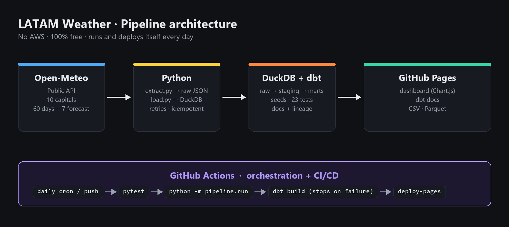

# LATAM Weather · Data Engineering Pipeline

End-to-end data pipeline that downloads daily weather for **10 Latin American capitals**, transforms and validates it with **dbt**, and publishes a public dashboard on **GitHub Pages**. Everything runs and deploys automatically with **GitHub Actions**. No AWS, no cost.

**Live demo:** https://dayan-18.github.io/clima-latam-pipeline/
**dbt docs (lineage):** https://dayan-18.github.io/clima-latam-pipeline/docs/



## Architecture

```
 ┌──────────────┐   ┌─────────────┐   ┌──────────────────────────────┐   ┌──────────────────┐
 │ Open-Meteo   │──▶│  Python     │──▶│  DuckDB  (warehouse)         │──▶│  GitHub Pages    │
 │ API (free)   │   │  extract.py │   │  raw → staging → marts (dbt) │   │  dashboard + docs│
 └──────────────┘   │  load.py    │   │  23 data quality tests       │   │  CSV / Parquet   │
                    └─────────────┘   └──────────────────────────────┘   └──────────────────┘
        ▲                                                                          │
        └──────────── GitHub Actions: daily cron + every push to main ◀────────────┘
```

| Layer | Tool | What it does |
|---|---|---|
| Ingestion | Python + `requests` | One API call for all 10 cities; stores the raw JSON in `data/raw/` |
| Storage | DuckDB | Single-file analytical database (`data/warehouse.duckdb`) |
| Transformation | dbt-core + dbt-duckdb | Seeds, staging, marts, data tests and documentation |
| Orchestration / CI/CD | GitHub Actions | Runs everything daily (cron) and on every push; if a test fails, nothing is deployed |
| Serving | GitHub Pages | Static dashboard, dbt docs and downloadable open data |

## Data model

```
raw.weather_daily   ─▶ stg_open_meteo__weather_daily ─┬─▶ fct_weather_daily ─┐
seeds.weather_codes ──────────────────────────────────┘                      ├─▶ mart_city_summary
seeds.cities (+ elevation from staging) ────────────────▶ dim_cities ────────┘
```

- `fct_weather_daily`: one row per city per day (observed + forecast), with average temperature, daily range, weather description and a rainy-day flag.
- `dim_cities`: cities with elevation and timezone.
- `mart_city_summary`: city-level KPIs and a comparison with the 7-day forecast.

## Data quality

`dbt build` runs 23 tests: `unique`, `not_null`, `relationships`, `accepted_values`, a custom generic test (`value_between`) and a singular test (`temp_max >= temp_min`). If any of them fails, the workflow stops and the previous version of the site stays online.

## Run it locally

Requires Python 3.11+.

```bash
python -m venv .venv
# Windows: .venv\Scripts\activate   |   Linux/Mac: source .venv/bin/activate
pip install -r requirements.txt
pytest -q
python -m pipeline.run
python -m http.server 8000 --directory public   # open http://localhost:8000
```

## Deploy your own copy

1. Fork this repository (it must be **public** for free GitHub Pages).
2. On GitHub: **Settings → Pages → Build and deployment → Source: GitHub Actions**.
3. Push to `main` (or go to **Actions → Data pipeline → Run workflow**).
4. After 1–2 minutes the site is live at `https://<your-user>.github.io/<repo>/`.

From then on it refreshes itself every day at 11:00 UTC.

## Project structure

```
.github/workflows/pipeline.yml   CI/CD: tests → pipeline → deploy to Pages
pipeline/                        extract.py, load.py, export_site.py, run.py
dbt/                             dbt project (seeds, models, tests, macros)
site/index.html                  dashboard template (Chart.js)
tests/                           unit tests (pytest)
```

## Data source

[Open-Meteo](https://open-meteo.com/) — free weather API, no API key required (CC BY 4.0).

## Author

[Dayan-18](https://github.com/Dayan-18)
